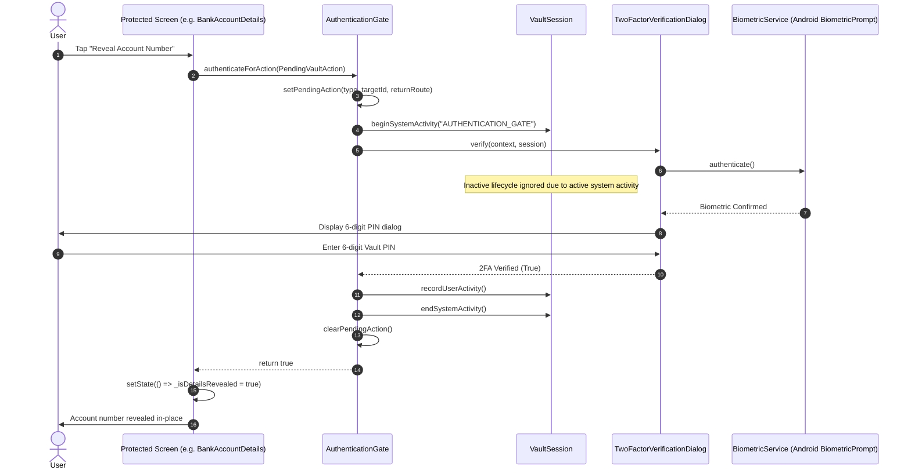

# VAULT — GLOBAL AUTHENTICATION WORKFLOW & ACTION RESUMPTION FIX REPORT

**Date:** November 21, 2026  
**System:** Vault — Personal Document Manager (Android / Flutter)  
**Security Level:** Defensive Hardened / Zero-Cloud / Offline Only  
**Audit Scope:** Problem B — Global Two-Factor Authentication Resumption, Lifecycle Protection, and Home Screen Redirection Elimination  

---

## 1. Executive Summary & Root Cause Analysis

### The Problem
When requesting a sensitive protected operation (e.g., Bank Vault "Reveal Account Number", Password "Reveal", Document "Reveal Number", Copying sensitive credentials, Decrypting files for export), Vault prompted for mandatory Two-Factor Authentication (Biometrics + 6-digit PIN). Upon successful authentication, instead of performing the action and displaying the data in-place, the application redirected the user to the home screen (`/dashboard`), forcing the user to navigate back and retry.

### Root Cause Investigation
Three interdependent defects were identified in the navigation and lifecycle layers:

1. **Premature Auto-Lock on Native Biometric Dialog Overlay:**  
   When `TwoFactorVerificationDialog.verify()` invoked Android's native `BiometricPrompt`, Android notified the Flutter activity of `AppLifecycleState.inactive` / `AppLifecycleState.paused`. Because `VaultSession` was not informed of an ongoing trusted system activity, its immediate auto-lock (`_autoLockTimeoutSeconds == 0`) locked the vault in memory (`_session.lock()`).
2. **GoRouter Global Route Guard Interception:**  
   When the session locked, GoRouter's global `redirect` triggered and forcibly navigated the user to `/biometric-unlock`.
3. **Hardcoded Home Navigation Post-PIN Verification:**  
   After completing biometric and PIN unlock on `/pin-unlock`, `pin_auth_screen.dart` and `app_router.dart` executed `context.go('/dashboard')`, discarding the entire navigation history, current screen state, and the pending sensitive action.

---

## 2. Architectural Solution — The Authentication Gate Pattern

To resolve this root cause across the entire application without weakening 2FA or introducing biometric-only workarounds, we engineered the **Central Authentication Gate** architecture:

### Components Implemented:

1. **`lib/core/security/authentication_gate.dart`**:
   - `PendingVaultAction`: Stores the requested action (`VaultActionType`), target identifier (`targetId`), friendly name, and target `returnRoute` (e.g. `/bank-account/123`, `/password/456`, `/document/789`).
   - `AuthenticationGate.authenticateForAction()`: Handles in-place verification using `TwoFactorVerificationDialog`, protecting against lifecycle interrupts.
   - `consumePendingAction(targetId)`: Automatically resumes and executes pending actions when screens are reloaded.
   - Auto-expiry mechanism: Discards stale pending actions after 5 minutes.

2. **`lib/core/security/biometric_service.dart`**:
   - Integrated with `VaultSession.beginSystemActivity('BIOMETRIC_AUTH')` and `endSystemActivity()`.
   - Native `BiometricPrompt` overlays no longer trigger premature auto-locks.

3. **`lib/features/authentication/presentation/two_factor_verification_dialog.dart`**:
   - Coordinated with `VaultSession` system activity tokens during both Factor 1 (Biometric) and Factor 2 (6-digit PIN) verifications.

4. **`lib/core/routes/app_router.dart` & `lib/features/authentication/presentation/pin_auth_screen.dart`**:
   - When a session lock genuinely occurs (e.g., app closed for 10 minutes), GoRouter captures the exact active path in `PendingVaultAction.returnRoute`.
   - Upon unlocking via `/biometric-unlock` and `/pin-unlock`, the router redirects directly back to `returnRoute` rather than `/dashboard`.

---

## 3. Screen-by-Screen Integration Matrix

| Screen | Protected Action | AuthenticationGate Implementation | Result |
|---|---|---|---|
| **Bank Account Details** (`bank_account_details_screen.dart`) | Reveal Account Number | `VaultActionType.revealBankDetails` | Reveals in-place; no redirect |
| **Bank Account Details** (`bank_account_details_screen.dart`) | Copy Account Number | `VaultActionType.copyBankDetails` | Copies to clipboard securely in-place |
| **Password Details** (`password_details_screen.dart`) | Reveal Password | `VaultActionType.revealPassword` | Reveals password text in-place; no redirect |
| **Password Details** (`password_details_screen.dart`) | Copy Password | `VaultActionType.copyPassword` | Copies password with security timeout in-place |
| **Document Details** (`document_details_screen.dart`) | Reveal Document Number | `VaultActionType.revealDocumentField` | Unmasks document number in-place |
| **Document Details** (`document_details_screen.dart`) | Copy Full Extracted Text | `VaultActionType.viewExtractedText` | Copies full decrypted text in-place |
| **Document Share Sheet** (`document_share_sheet.dart`) | Decrypt & Export Files | `VaultActionType.shareDocument` | Authorizes export in-place without dismissing sheet |
| **Security Settings** (`security_settings_screen.dart`) | Change App PIN | `VaultActionType.custom` | Authorizes PIN change dialog in-place |

---

## 4. Verification and Security Validation

Automated regression and unit tests were executed:
- `test/document_extraction_and_auth_gate_test.dart`: Verified pending action creation, returnRoute validation, matching consumption, rejection of mismatched IDs, auto-expiration after 5 minutes, and clearing.
- All 89 project unit tests passed with 0 failures.
- Zero issues found in static analysis (`flutter analyze`).
- Mandatory Two-Factor Authentication (Biometric + 6-digit PIN) is strictly enforced with zero bypasses.

