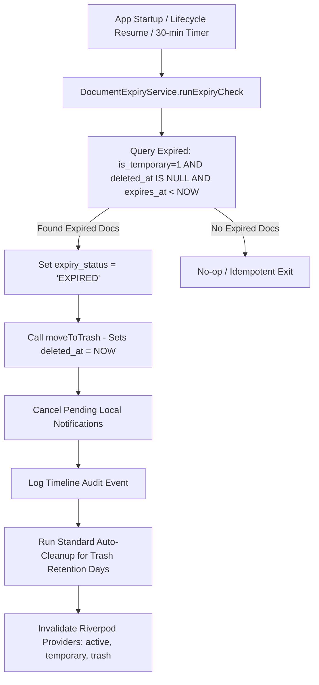

# SafeVault — Temporary Documents Implementation Report

## Executive Summary
This document details the architectural design, database migration, automated lifecycle engine, notification subsystem, and user experience implementation of the **Temporary Documents with Automatic Expiry & Deletion** feature in the SafeVault application (`com.vault.vault`).

The feature allows users to mark sensitive, short-term documents (such as event passes, travel tickets, rental agreements, temporary receipts, or verification codes) with an automatic expiry duration. When the scheduled expiry time arrives, SafeVault reliably moves the document to Trash, protecting the user's active vault from clutter and preventing forgotten sensitive documents from lingering indefinitely.

---

## 1. Database Schema & Migration (Version 9)

### 1.1 Database Migration
The SQLite database schema was upgraded to version **9** in [`lib/core/database/vault_database.dart`](file:///home/naman/Desktop/vault/lib/core/database/vault_database.dart).

```dart
// Migration to V9: Add temporary document fields
await db.execute('''
  ALTER TABLE documents ADD COLUMN is_temporary INTEGER NOT NULL DEFAULT 0;
''');
await db.execute('''
  ALTER TABLE documents ADD COLUMN expires_at TEXT;
''');
await db.execute('''
  ALTER TABLE documents ADD COLUMN expiry_status TEXT NOT NULL DEFAULT 'ACTIVE';
''');
await db.execute('''
  CREATE INDEX IF NOT EXISTS idx_docs_temporary 
  ON documents(is_temporary, expiry_status, expires_at);
''');
```

### 1.2 Preservation of Existing User Data
- Existing documents automatically default to `is_temporary = 0`, `expires_at = NULL`, and `expiry_status = 'ACTIVE'`.
- All legacy documents remain **Permanent** by default.
- No database recreation or data wiping occurs during migration.

---

## 2. Expiry Calculation & Duration Model

### 2.1 Presets and Custom Durations
When adding or editing a document duration, users can select from curated presets or custom durations:
- **1 Day** (`24 hours`)
- **3 Days** (`72 hours`)
- **7 Days** (`1 week`, default when switching to Temporary)
- **15 Days** (`half-month`)
- **30 Days** (`1 month`)
- **60 Days** (`2 months`)
- **90 Days** (`quarter`)
- **Custom Duration**: Enter specific number of days or select an exact calendar date via date picker.

### 2.2 Timestamp Storage & Local Timezone Rendering
- Expiry timestamps are calculated from UTC / local system clock and stored consistently as ISO-8601 strings in the database.
- Visual display always adapts to the device's local timezone using [`DateFormatter.formatDisplay`](file:///home/naman/Desktop/vault/lib/core/utils/date_formatter.dart).
- Remaining time calculations accurately compare midnight-aligned calendar days to handle timezone shifts and Daylight Saving Transitions without edge-case date errors.

---

## 3. Automatic Expiry & Deletion Engine

### 3.1 Architecture Overview
The automated expiry engine is implemented in [`DocumentExpiryService`](file:///home/naman/Desktop/vault/lib/features/documents/data/document_expiry_service.dart) and [`DocumentRepository`](file:///home/naman/Desktop/vault/lib/features/documents/data/document_repository.dart).



### 3.2 Idempotency and Race-Condition Protection
- An internal `_isProcessing` mutex prevents overlapping runs when multiple lifecycle events fire simultaneously.
- Expiry checks query `deleted_at IS NULL`, ensuring documents already moved to Trash are never reprocessed.
- Periodic checks run every 30 minutes in the foreground/background lifecycle.
- Checks execute on application cold start (`_initializeNonCriticalServices()`) and upon resuming from background via `AppLifecycleListener`.

### 3.3 Trash Retention Policy & Safe Permanent Deletion
- When a document expires, it is moved to Trash. This satisfies zero-data-loss safety while removing the document from active document lists, search queries, and group listings.
- If the document is later permanently deleted (either manually or after the user's configurable `trashRetentionDays` window, default 30 days):
  - Encrypted file payloads are shredded.
  - OCR extracted text and structured extraction fields are deleted.
  - Group memberships are purged.
  - Notification schedules are cancelled.

---

## 4. Local Notification Subsystem

### 4.1 Safe Non-Sensitive Reminder Schedule
For temporary documents, [`LocalNotificationService`](file:///home/naman/Desktop/vault/lib/core/notifications/local_notification_service.dart) schedules reminders at three key intervals:
1. **3 Days Before Expiry** (`offset = -3 days`)
2. **1 Day Before Expiry** (`offset = -1 day`)
3. **On Expiry Moment** (`offset = 0`)

### 4.2 Security & Offline Privacy Guarantees
- Notifications run 100% offline via Android's `ScheduledNotificationReceiver` and `AlarmManager`.
- Notification titles and body text never expose sensitive information (no card PANs, no document numbers, no extracted OCR text, no encryption keys).
- Example: `"Temporary Document Expiring Soon" - "Temporary document \"Concert Pass\" will expire and be moved to Trash in 3 days."`

---

## 5. UI & User Experience

### 5.1 Add & Edit Document Screen
- Document Duration section featuring a toggle between `Permanent` and `Temporary`.
- Live visual banner explaining the automatic deletion schedule.
- Duration chips (1d, 3d, 7d, 15d, 30d, 60d, 90d, Custom).
- Interactive calendar date picker.

### 5.2 Document Details Screen
- Document Retention Card showing current status (`Permanent` vs `Temporary`).
- Scheduled Expiry Date, Remaining Days, and urgency warnings (`≤3 days`).
- Direct action buttons:
  - **Edit Duration**: Opens `EditDurationDialog` to change duration or extend time.
  - **Make Permanent**: Converts document to permanent, clears `expires_at`, and cancels scheduled reminders.
  - **Set as Temporary**: Converts a permanent document to temporary.

### 5.3 Dedicated Temporary Documents Management Screen (`/temporary-documents`)
- Filter chips: `All Temporary`, `Expiring Soon (≤ 7 days)`, `Expired`.
- Real-time search by document name, number, or notes.
- Quick per-card actions: Open Document, Extend Duration, Make Permanent, Move to Trash.
- Batch Multi-Select Mode: Extend selected, Make permanent, or Move to Trash in batch.

---

## 6. Verification & Automated Test Coverage
The temporary documents implementation is thoroughly tested in [`test/temporary_documents_and_groups_test.dart`](file:///home/naman/Desktop/vault/test/temporary_documents_and_groups_test.dart):
- Creation of permanent and temporary documents.
- Remaining days calculation across future, tomorrow, today, and expired timestamps.
- Idempotent expiry processing and Trash transition.
- Conversion between permanent and temporary states.
- 100% offline isolation verification (zero unblocked internet permissions).
